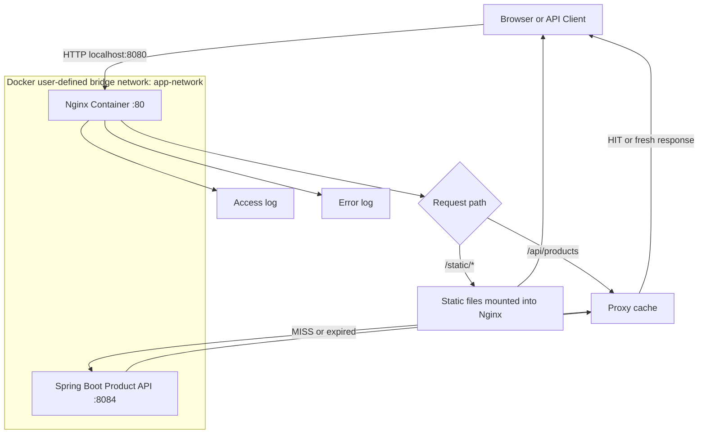
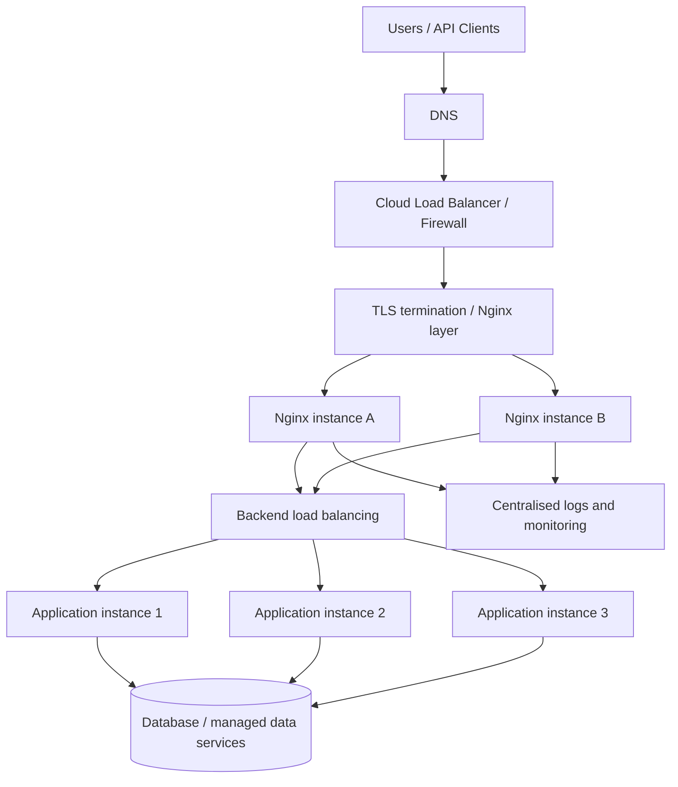

# Nginx + Spring Boot API

A hands-on Nginx learning project using an existing Spring Boot API, Docker, and an Ubuntu virtual machine.

This repository demonstrates Nginx as a reverse proxy, static-file server, and caching layer. It also documents broader Nginx concepts used in production so a beginner can follow the practical work and continue learning.

> **Project scope:** One Nginx container, one existing Spring Boot API container, and one Docker user-defined bridge network. No Docker Compose, Kubernetes, database, Redis, or additional backend services are required.

## Contents

1. [What is Nginx?](#1-what-is-nginx)
2. [Production use cases](#2-production-use-cases)
3. [Architecture](#3-architecture)
4. [Implemented features](#4-implemented-features)
5. [Prerequisites](#5-prerequisites)
6. [Repository structure](#6-repository-structure)
7. [Run from scratch](#7-run-from-scratch)
8. [Configuration explained](#8-configuration-explained)
9. [Test the project](#9-test-the-project)
10. [Useful commands](#10-useful-commands)
11. [Nginx learning reference](#11-nginx-learning-reference)
12. [Production considerations](#12-production-considerations)
13. [Troubleshooting](#13-troubleshooting)
14. [Suggested exercises](#14-suggested-exercises)

## 1. What is Nginx?

Nginx (pronounced *engine-x*) is web-server and reverse-proxy software. It accepts HTTP/HTTPS requests and determines how to handle them.

For example, a client requests `/api/products`. Nginx can forward that request to a Spring Boot application, receive the response, and return it to the client. For `/static/index.html`, Nginx can read and return the file itself without involving Spring Boot.

Nginx is commonly used as:
- A web server for static content.
- A reverse proxy in front of application servers.
- A load balancer across backend instances.
- A TLS/HTTPS termination point.
- A caching layer for eligible responses.
- A traffic-control layer using rate limits and access rules.

## 2. Production use cases

| Use case | What Nginx does | Why it is useful |
|---|---|---|
| Reverse proxy | Forwards requests to backend services | Separates public entry point from application servers |
| Load balancing | Distributes requests across backend instances | Improves capacity and availability |
| Static file serving | Returns files directly | Avoids using application resources for simple file delivery |
| TLS termination | Handles HTTPS and forwards traffic internally | Centralises certificate and TLS configuration |
| Response caching | Reuses eligible upstream responses | Can reduce backend work and latency |
| Rate limiting | Restricts request rates | Helps protect services from excessive traffic |
| Access control | Allows or denies selected clients/paths | Adds a traffic-level access-control layer |
| Compression | Compresses eligible responses | Reduces network transfer size |
| WebSocket proxying | Proxies upgraded, persistent connections | Supports real-time communication |
| Logging | Records requests and errors | Helps investigate traffic and failures |

Nginx does not replace application authentication, authorisation, business validation, or a complete API-management platform.

## 3. Architecture

### 3.1 Architecture implemented in this repository



| Client URL | Nginx behaviour | Destination |
|---|---|---|
| `http://localhost:8080/api/products` | Reverse proxy with cache policy | `product-api-nginx:8084` |
| `http://localhost:8080/static/index.html` | Serves file directly | Nginx static directory |
| `http://localhost:8080/static/css/style.css` | Serves file directly | Nginx static directory |

Only Nginx publishes a host port. The Product API is reachable by Nginx over the Docker network and does not need a host-published port.

### 3.2 Conceptual production architecture

This is a learning diagram, not a deployment created by this repository.



The actual arrangement depends on the platform. TLS may terminate at a cloud load balancer or at Nginx. Multiple Nginx instances are commonly placed behind a highly available network entry point.

## 4. Implemented features

| Feature | Status | Location |
|---|---|---|
| Docker user-defined bridge network | Implemented | Docker setup commands |
| Nginx reverse proxy | Implemented | `nginx/conf.d/product-api.conf` |
| Forwarded request headers | Implemented | `product-api.conf` |
| Access and error logging | Implemented | `product-api.conf` and `logs/` mount |
| Static HTML and CSS serving | Implemented | `static/` and `product-api.conf` |
| Proxy response caching | Implemented | `cache.conf` and `product-api.conf` |
| Persistent cache volume | Implemented | Docker volume `nginx-cache` |
| Load balancing | Learning reference only | Section 11 |
| TLS termination | Learning reference only | Section 11 |
| Rate limiting | Learning reference only | Section 11 |
| IP access control | Learning reference only | Section 11 |
| Security headers | Learning reference only | Section 11 |
| Gzip compression | Learning reference only | Section 11 |
| WebSocket proxying | Learning reference only | Section 11 |
| Kubernetes Ingress | Learning reference only | Section 11 |

The distinction matters: this repository only claims features that can be reproduced from its committed files and instructions.

## 5. Prerequisites

Use an **Ubuntu virtual machine** with:
- Docker Engine installed and running.
- Git installed.
- Network access to pull Docker images.
- The existing Product API image: `diva2505/nginx-product-api:v1`.

Check:

```bash
docker --version
docker info
git --version
```

If your Ubuntu user cannot access Docker directly, use `sudo` with Docker commands or configure Docker permissions according to your VM's security policy.

> The Product API image is an external prerequisite. This repository does not contain the Spring Boot application source code.

## 6. Repository structure

```text
nginx-product-api-project/
├── nginx/
│   └── conf.d/
│       ├── cache.conf
│       └── product-api.conf
├── static/
│   ├── index.html
│   └── css/
│       └── style.css
├── logs/                  # Runtime logs; not committed
├── .gitignore
└── README.md
```

| Path | Purpose |
|---|---|
| `nginx/conf.d/cache.conf` | Defines the proxy cache zone |
| `nginx/conf.d/product-api.conf` | HTTP server, proxy routes, static route, and logs |
| `static/index.html` | Sample page served directly by Nginx |
| `static/css/style.css` | Stylesheet served directly by Nginx |
| `logs/` | Host directory mounted for runtime logs; generated locally |

Cache data is stored in a Docker named volume, not in Git.

## 7. Run from scratch

Run commands from the repository root.

### 7.1 Clone the repository

```bash
git clone <YOUR_GITHUB_REPOSITORY_URL>
cd nginx-product-api-project
```

Replace the placeholder with your actual GitHub URL.

### 7.2 Pull images

```bash
docker pull nginx:latest
docker pull diva2505/nginx-product-api:v1
```

### 7.3 Create the Docker network

```bash
docker network create app-network
docker network inspect app-network
```

If the network already exists, reuse it; do not create a differently named network.

A user-defined bridge network allows containers to communicate using Docker DNS and container names.

### 7.4 Start the Product API

```bash
docker run -d \
  --name product-api-nginx \
  --network app-network \
  diva2505/nginx-product-api:v1
```

Verify:

```bash
docker ps -a
docker logs product-api-nginx
```

The application must listen on port `8084` inside its container. No `-p 8084:8084` mapping is required because Nginx reaches the API over the shared Docker network.

### 7.5 Create log directory and cache volume

```bash
mkdir -p logs
docker volume create nginx-cache
```

The log directory is mounted from the Ubuntu VM. The cache volume is managed by Docker.

### 7.6 Start Nginx

```bash
docker run -d \
  --name nginx-docker \
  --network app-network \
  -p 8080:80 \
  -v "$(pwd)/nginx/conf.d:/etc/nginx/conf.d:ro" \
  -v "$(pwd)/logs:/var/log/nginx" \
  -v nginx-cache:/var/cache/nginx \
  -v "$(pwd)/static:/usr/share/nginx/html/static:ro" \
  nginx:latest
```

| Option | Purpose |
|---|---|
| `-d` | Runs the container in the background |
| `--name nginx-docker` | Assigns a predictable container name |
| `--network app-network` | Connects Nginx to the API's network |
| `-p 8080:80` | Publishes host port 8080 to container port 80 |
| Config bind mount | Mounts Nginx configuration read-only |
| Log bind mount | Makes logs available on the host |
| Named volume | Stores cache data in Docker-managed storage |
| Static bind mount | Makes static files available read-only |

### 7.7 Verify

```bash
docker ps
docker network inspect app-network
docker exec nginx-docker nginx -t
docker logs nginx-docker
```

Both containers should be running and attached to `app-network`. Nginx validation should report that syntax is OK and the test is successful.

## 8. Configuration explained

### 8.1 Cache zone — `nginx/conf.d/cache.conf`

```nginx
proxy_cache_path /var/cache/nginx
    levels=1:2
    keys_zone=product_cache:10m
    max_size=100m
    inactive=10m
    use_temp_path=off;
```

| Directive / parameter | Meaning |
|---|---|
| `proxy_cache_path` | Defines the disk path for cached responses |
| `levels=1:2` | Organises cache files into directory levels |
| `keys_zone=product_cache:10m` | Creates shared-memory metadata zone `product_cache` with 10 MB |
| `max_size=100m` | Sets the approximate maximum disk cache size |
| `inactive=10m` | Removes entries unused for 10 minutes |
| `use_temp_path=off` | Writes temporary cache files directly in the cache filesystem |

The cache zone is defined in the HTTP context. The official Nginx image includes files from `/etc/nginx/conf.d/*.conf` inside its HTTP configuration.

### 8.2 Server and routes — `nginx/conf.d/product-api.conf`

```nginx
server {
    listen 80;
    server_name localhost;

    access_log /var/log/nginx/access.log;
    error_log /var/log/nginx/error.log warn;

    location ^~ /api/products {
        proxy_pass http://product-api-nginx:8084;

        proxy_set_header Host $host;
        proxy_set_header X-Real-IP $remote_addr;
        proxy_set_header X-Forwarded-For $proxy_add_x_forwarded_for;
        proxy_set_header X-Forwarded-Proto $scheme;

        proxy_cache product_cache;
        proxy_cache_methods GET HEAD;
        proxy_cache_valid 200 30s;
        proxy_cache_bypass $http_authorization;
        proxy_no_cache $http_authorization;

        add_header X-Cache-Status $upstream_cache_status always;
    }

    location /static/ {
        alias /usr/share/nginx/html/static/;
        index index.html;
    }

    location / {
        proxy_pass http://product-api-nginx:8084;

        proxy_set_header Host $host;
        proxy_set_header X-Real-IP $remote_addr;
        proxy_set_header X-Forwarded-For $proxy_add_x_forwarded_for;
        proxy_set_header X-Forwarded-Proto $scheme;
    }
}
```

Important directives:

| Directive | Explanation |
|---|---|
| `listen 80` | Listens on port 80 inside Nginx |
| `server_name localhost` | Selects this server block for the local test host |
| `location` | Selects how a request URI is handled |
| `^~ /api/products` | Gives this prefix priority over regular-expression locations |
| `proxy_pass` | Forwards the request to the backend |
| `proxy_set_header` | Controls headers sent to the upstream |
| `proxy_cache` | Enables the named cache zone |
| `proxy_cache_valid 200 30s` | Caches HTTP 200 responses for 30 seconds |
| `proxy_cache_bypass` | Avoids serving cached data when Authorization is present |
| `proxy_no_cache` | Prevents storing responses when Authorization is present |
| `add_header` | Exposes cache status in the response |
| `alias` | Maps a URI location to a filesystem path |
| `access_log` | Records processed HTTP requests |
| `error_log` | Records Nginx warnings and errors |

#### Why use the container name in `proxy_pass`?

```nginx
proxy_pass http://product-api-nginx:8084;
```

Docker's embedded DNS resolves `product-api-nginx` to the API container's IP because both containers share a user-defined network.

Do not use `localhost` here. Inside the Nginx container, `localhost` refers to Nginx itself, not the Product API.

#### Why is the API port not published?

Only Nginx needs a public host mapping:

```text
Host port 8080 → Nginx port 80
Nginx → Product API container port 8084
```

Publishing the API port is optional and unnecessary for this reverse-proxy setup.

#### `proxy_pass` URI behaviour

This project's `proxy_pass` has no URI suffix:

```nginx
proxy_pass http://product-api-nginx:8084;
```

The original request URI is forwarded. For example, `/api/products` reaches the backend as `/api/products`.

### 8.3 Static file mapping

```nginx
location /static/ {
    alias /usr/share/nginx/html/static/;
    index index.html;
}
```

The Docker bind mount maps the repository's `static/` directory to `/usr/share/nginx/html/static/` inside the container.

```text
/static/index.html
        ↓
/usr/share/nginx/html/static/index.html
```

The trailing slashes in this `location` and `alias` pairing are intentional.

### 8.4 Cache behaviour and limitations

This project uses a 30-second cache to make the behaviour easy to observe.

- `MISS`: No usable cached response was found; Nginx contacted the upstream.
- `HIT`: Nginx served a valid cached response.
- `BYPASS`: The configured bypass condition prevented cache use.
- `EXPIRED`: A previously cached response expired and needed to be fetched again.

The configuration bypasses and avoids storing responses when an Authorization header is present. This is a learning example, not a complete cache-safety policy. Production caching must account for cookies, user-specific data, query parameters, cache keys, upstream cache-control headers, invalidation, and consistency requirements. Do not cache authenticated or personalised responses unless the cache policy has been deliberately designed and reviewed.

## 9. Test the project

### 9.1 Reverse proxy

```bash
curl -i http://localhost:8080/api/products
```

Expected: response from the Spring Boot Product API.

### 9.2 Static HTML

```bash
curl -i http://localhost:8080/static/index.html
```

Open `http://localhost:8080/static/index.html` in a browser.

### 9.3 Static CSS

```bash
curl -i http://localhost:8080/static/css/style.css
```

Expected: HTTP 200 and CSS content.

### 9.4 Proxy cache

Send the same request twice within 30 seconds:

```bash
curl -i http://localhost:8080/api/products
curl -i http://localhost:8080/api/products
```

Inspect `X-Cache-Status`. The first eligible request should normally be `MISS`; a subsequent eligible request should normally be `HIT`.

After the 30-second TTL, a later request may become a `MISS` again.

### 9.5 Access logging

```bash
cat logs/access.log
tail -f logs/access.log
```

Send requests from another terminal. Press `Ctrl+C` to stop following the log.

### 9.6 Backend failure and error logging

```bash
docker stop product-api-nginx
curl -i http://localhost:8080/api/products
cat logs/error.log
docker start product-api-nginx
```

A backend connection failure commonly results in HTTP 502. A still-valid cached response may be returned instead, so use an uncached request or wait for the cache entry to expire when testing the failure.

## 10. Useful commands

### Docker

```bash
docker ps
docker ps -a
docker inspect nginx-docker
docker network inspect app-network
docker logs nginx-docker
docker logs product-api-nginx
docker logs -f nginx-docker
docker exec -it nginx-docker sh
docker exec nginx-docker nginx -t
docker exec nginx-docker nginx -s reload
docker stop nginx-docker
docker start nginx-docker
docker volume ls
docker volume inspect nginx-cache
```

### Apply configuration-only changes

```bash
docker exec nginx-docker nginx -t
docker exec nginx-docker nginx -s reload
```

Validate before reloading.

### Recreate Nginx after changing mounts

A running container cannot have new mounts added. Remove and recreate only Nginx:

```bash
docker rm -f nginx-docker
```

Then run the Nginx `docker run` command from section 7.6.

### Cleanup

These commands remove the containers and network. The last command also removes the cache volume and its contents.

```bash
docker rm -f nginx-docker product-api-nginx
docker network rm app-network
docker volume rm nginx-cache
```

Only run cleanup when you intentionally want to remove the learning environment.

## 11. Nginx learning reference

This section covers broader topics useful for backend developers and production troubleshooting. Some are not enabled in this repository.

### 11.1 Master and worker processes

Nginx commonly uses a master-worker process model.

- **Master process:** Reads and validates configuration, manages workers, and handles lifecycle signals.
- **Worker processes:** Handle client connections and process requests.
- **Event-driven model:** Workers can handle many concurrent connections without requiring one operating-system process or thread per connection.

Inspect processes:

```bash
docker exec nginx-docker ps
```

### 11.2 Configuration contexts

Nginx configuration is organised into contexts:

- **Main context:** Process-level settings.
- **Events context:** Connection-processing settings.
- **HTTP context:** Shared HTTP configuration and virtual servers.
- **Server context:** A virtual server selected by listening address/port and server name.
- **Location context:** Rules for matching request URIs within a server.

Simplified example:

```nginx
http {
    server {
        listen 80;
        server_name example.com;

        location /api/ {
            proxy_pass http://backend;
        }
    }
}
```

A directive's valid context matters. For example, `proxy_cache_path` belongs in the HTTP context, not inside a `location` block.

The official Nginx Docker image includes `/etc/nginx/conf.d/*.conf` inside its HTTP configuration. That is why the repository's two configuration files work when mounted into that directory.

### 11.3 Request processing and location matching

Common location forms:

```nginx
location = /health { ... }          # Exact match
location ^~ /static/ { ... }        # Prefix; suppresses regex evaluation
location /api/ { ... }              # Prefix match
location ~ \.php$ { ... }           # Case-sensitive regular expression
location ~* \.(jpg|png)$ { ... }    # Case-insensitive regular expression
```

Exact matches are checked first. Nginx then finds the longest prefix match. A `^~` prefix prevents subsequent regular-expression locations from taking precedence. Otherwise, regular-expression locations are evaluated in configuration order; if none wins, the longest prefix is used.

Nginx does not simply select the first `location` written in the file.

### 11.4 Reverse proxy

A reverse proxy accepts a client request and forwards it to an upstream application.

Typical uses:
- Keep application containers off public host ports.
- Provide a stable public endpoint while backend instances change.
- Centralise HTTP routing and forwarded headers.
- Apply caching, TLS, and traffic controls at the edge.

Implemented here with `proxy_pass`.

### 11.5 Load balancing

Nginx can distribute requests across multiple upstream servers.

Learning example:

```nginx
upstream product_backend {
    server product-api-1:8084;
    server product-api-2:8084;
    server product-api-3:8084;
}

server {
    listen 80;

    location /api/ {
        proxy_pass http://product_backend;
    }
}
```

| Method | Behaviour | Typical consideration |
|---|---|---|
| Round Robin | Distributes requests across servers in order | Simple default for similar instances |
| Least Connections | Selects the server with fewer active connections | Useful when request durations vary |
| IP Hash | Uses client IP to select a server | Basic affinity, with limitations |

This is not part of the running project, which has one Product API container.

### 11.6 TLS termination

Nginx can terminate HTTPS and proxy requests to an internal backend.

Learning example:

```nginx
server {
    listen 443 ssl;
    server_name example.com;

    ssl_certificate     /etc/nginx/certs/fullchain.pem;
    ssl_certificate_key /etc/nginx/certs/private.key;

    location / {
        proxy_pass http://backend;
    }
}
```

A real deployment also needs certificate provisioning and renewal, secure TLS protocol/cipher configuration, correct file permissions, and a deliberate policy for traffic between Nginx and the backend. TLS is not configured here.

### 11.7 Proxy caching

Caching stores eligible upstream responses so later requests can be served without contacting the backend.

Useful for public catalogue data and read-heavy reference data that changes infrequently. Production design must address cache keys, TTL, invalidation, stale data, cookies, authorization, and upstream cache-control headers.

A cache should not be applied blindly to personalised or authenticated responses.

### 11.8 Rate limiting

Rate limiting controls how frequently a client can make requests.

Learning example:

```nginx
http {
    limit_req_zone $binary_remote_addr zone=api_limit:10m rate=5r/s;

    server {
        location /api/ {
            limit_req zone=api_limit burst=10 nodelay;
            proxy_pass http://backend;
        }
    }
}
```

This defines a per-client-IP rate of five requests per second with a burst allowance. Production values must reflect legitimate traffic and application requirements. Not enabled here.

### 11.9 Access control

Nginx can allow or deny traffic based on client IP addresses or networks.

```nginx
location /internal/ {
    allow 10.0.0.0/8;
    deny all;

    proxy_pass http://backend;
}
```

This is a network-level restriction, not a substitute for application authentication and authorisation. Consider trusted proxies and real client IP handling when deployed behind another load balancer. Not enabled here.

### 11.10 Security headers

Nginx can add response headers:

```nginx
add_header X-Content-Type-Options "nosniff" always;
add_header X-Frame-Options "SAMEORIGIN" always;
add_header Referrer-Policy "strict-origin-when-cross-origin" always;
```

A Content Security Policy must be designed for the actual frontend. HSTS should only be enabled when HTTPS is correctly deployed and the domain's HTTPS policy is understood. Not enabled here.

### 11.11 Gzip compression

Nginx can compress eligible responses:

```nginx
gzip on;
gzip_vary on;
gzip_min_length 1024;
gzip_types text/plain text/css application/json application/javascript application/xml;
```

Compression uses CPU, so measure it and configure suitable response types. Not enabled here.

### 11.12 WebSocket proxying

WebSocket uses an HTTP upgrade handshake. A reverse proxy must pass upgrade headers and use HTTP/1.1 upstream.

```nginx
location /ws/ {
    proxy_pass http://backend;
    proxy_http_version 1.1;
    proxy_set_header Upgrade $http_upgrade;
    proxy_set_header Connection "upgrade";
    proxy_read_timeout 3600s;
}
```

Choose timeouts based on the application's heartbeat and connection lifecycle. Not implemented here.

### 11.13 Nginx versus API Gateway

Nginx is commonly used for web serving, reverse proxying, load balancing, TLS termination, caching, and traffic control.

An API Gateway often provides broader API-management features such as consumer subscriptions, API keys, developer portals, usage plans, quotas, analytics, and policy management. Products overlap; choose based on whether the need is primarily HTTP traffic handling or full API lifecycle management.

### 11.14 Nginx and Kubernetes Ingress

In Kubernetes, an Ingress resource describes HTTP routing rules. An Ingress Controller watches those resources and implements the routing using a proxy or another data plane.

Nginx can be used as an Ingress Controller, but a standalone Nginx container like this project is not automatically a Kubernetes Ingress Controller. Kubernetes is outside this project's scope.

### 11.15 High availability

One Nginx instance is a single point of failure. Production deployments commonly use multiple proxy instances behind a highly available load balancer or another resilient network entry point.

High availability also requires:
- Health checks and failure handling.
- Redundant application instances.
- Capacity planning.
- Centralised logs and monitoring.
- Tested configuration rollout and rollback.
- Certificate and secret management.

A second Nginx container on the same single Docker host does not provide host-level high availability.

## 12. Production considerations

### Network and exposure
- Expose only the intended public entry point.
- Keep backend services on private networks where possible.
- Configure trusted proxy handling correctly.
- Do not assume a container name or internal IP is stable outside its intended network.

### Caching
- Cache only responses safe to share.
- Do not cache personalised or authenticated responses without a reviewed policy.
- Design cache keys, TTLs, invalidation, and stale-data behaviour deliberately.
- Monitor cache hit ratio and backend impact.

### TLS and security
- Use managed certificate issuance and renewal where appropriate.
- Protect private keys and secrets.
- Apply a tested TLS policy.
- Configure application authentication and authorisation independently.
- Review request-size limits, timeouts, access rules, and security headers.

### Reliability and operations
- Run multiple proxy and application instances when availability requires them.
- Configure meaningful health checks.
- Centralise access and error logs.
- Monitor latency, status codes, connection counts, and upstream failures.
- Test configuration changes before reload.
- Keep a rollback path for configuration and image changes.

### Cloud and Kubernetes
Nginx may run as a standalone reverse proxy, an Ingress Controller, or part of a larger edge architecture. Networking, service discovery, TLS ownership, health checks, and scaling depend on the platform. This repository focuses on Docker networking and a single-host learning setup.

## 13. Troubleshooting

### Nginx exits immediately

```bash
docker ps -a
docker logs nginx-docker
```

Validate the mounted configuration:

```bash
docker run --rm \
  -v "$(pwd)/nginx/conf.d:/etc/nginx/conf.d:ro" \
  nginx:latest nginx -t
```

Common causes: syntax errors, invalid directives, or a mount to the wrong path.

### `host not found in upstream`

```bash
docker ps -a
docker network inspect app-network
```

Both containers must be attached to the same network. The upstream hostname must match the API container name: `product-api-nginx`.

### `502 Bad Gateway`

```bash
docker ps -a
docker logs product-api-nginx
```

Confirm that the API started and listens on port `8084` inside its container. Verify shared network membership.

### Static file returns 403 or 404

```bash
find static -type f
docker exec nginx-docker ls -la /usr/share/nginx/html/static
```

Check that the `alias` path matches the mount destination and that Nginx can read the files.

### Cache always reports `MISS`

Check:
- The request uses `/api/products`.
- The upstream response is eligible for caching.
- The status matches the configured 200 response rule.
- Requests occur within the 30-second TTL.
- The request has no Authorization header.
- Upstream cache-control headers do not prevent caching.

```bash
curl -i http://localhost:8080/api/products
```

### Port 8080 is already in use

```bash
sudo ss -ltnp | grep ':8080'
```

Stop the conflicting service or choose another host port in the Docker `-p` mapping.

### Configuration changed but behaviour did not

```bash
docker exec nginx-docker nginx -t
docker exec nginx-docker nginx -s reload
```

If a mount must change, recreate the container. Validate and reload configuration deliberately.

## 14. Suggested exercises

1. Change cache TTL from 30 to 60 seconds and observe cache behaviour.
2. Add another static page and serve it through a separate URI.
3. Add a dedicated `/health` response at Nginx level and compare it with an application health endpoint.
4. Configure a rate limit and observe what happens when the limit is exceeded.
5. Add security headers and inspect them with `curl -I`.
6. Configure gzip and compare response headers.
7. Create a local test TLS certificate and configure HTTPS in a separate learning environment.
8. Extend the backend to multiple instances and experiment with Nginx load-balancing methods.
9. Add a WebSocket endpoint to a test application and configure proxy upgrade headers.
10. Explore how an Nginx Ingress Controller differs from this standalone Docker deployment.

---

This project connects Nginx concepts with a working Java/Spring Boot backend deployment pattern. Start with the practical implementation, inspect requests and logs, then use the learning-reference sections to understand how the same concepts expand into production architectures.

The examples are educational starting points. Production configurations must be adapted, security-reviewed, load-tested, and monitored for the application and platform where they will run.
